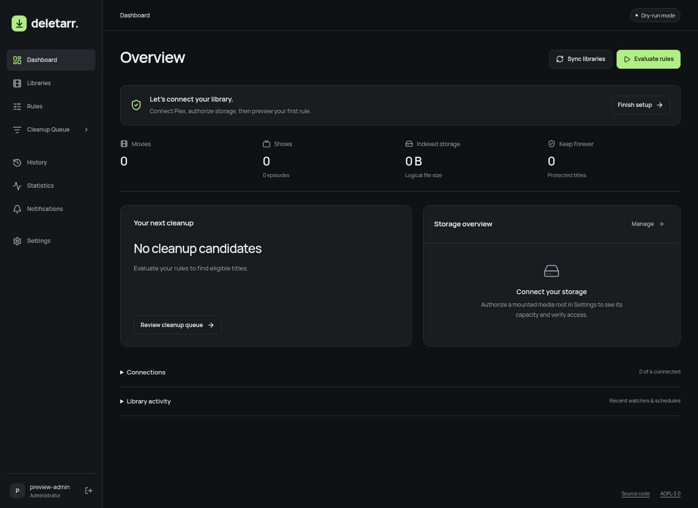

# Deletarr

**Intelligent media retention and automated library cleanup.**

Deletarr is a self-hosted retention manager for Plex libraries, with optional Radarr, Sonarr and Seerr coordination. It explains what qualifies, shows an exact deletion plan, and checks playback, protection, paths and file identities again before execution.

A single non-root container serves the React interface, FastAPI backend, SQLite database and durable job worker. No external database, broker, analytics or telemetry service is required.



## Deployment

**NAS without SSH:** use the prebuilt preview image and paste
[compose.nas.yaml](compose.nas.yaml) into your NAS Docker project's editor.
See the [browser-only NAS instructions](docs/NAS.md), including first-run
token retrieval through the container console and package visibility checks.

Use a Linux Docker host with Compose v2. The container supports the Linux filesystem APIs used for descriptor-relative deletion. Native Windows execution is unsupported; Windows Docker Desktop must run Linux containers. NAS compatibility depends on working Linux bind mounts, UID/GID permissions and stable filesystem identities; UGOS Pro has not been tested on hardware.

```sh
cp .env.example .env
# Edit .env: set existing movie/TV host paths and your intended UID/GID.
mkdir -p config
sudo chown 10001:10001 config
sudo chmod 700 config
docker compose up -d --build
```

Open **http://localhost:8980**. Read `config/setup-token` locally and enter it in the first-run account form. The token is removed once the administrator is created. There is no public registration. Do not paste installation tokens, API keys or passwords into issues.

Compose binds to loopback by default. For LAN access, deliberately set `DELETARR_BIND` to your host LAN IP, or configure a reverse proxy. For HTTPS, set `DELETARR_ORIGIN` to the exact external origin and `DELETARR_SECURE_COOKIE=true` in the container environment. See [configuration](docs/CONFIGURATION.md).

The default Compose file builds a local image. The NAS preview workflow publishes
AMD64/ARM64 images to `ghcr.io/cloudcookch/deletearr:preview` on application changes
to the `deletarr` branch. Check its successful workflow run before pulling a new
preview. The release workflow separately publishes versioned images after a
deliberate GitHub release. Preview builds are for testing, not production certification.

## First run

1. Create the local administrator with a password of at least 12 characters.
2. Configure Plex, explicitly trust its LAN destination where needed, and test the connection.
3. Discover libraries and explicitly enable management. New libraries are excluded.
4. Optionally configure Radarr, Sonarr and Seerr. Each has a connection test.
5. Authorize mounted roots, such as `/media/movies`, then map the source prefix from each integration to the corresponding root.
6. Run a full sync. Review file identities, missing mappings and uncertain watch history.
7. Create a retention rule and simulate it. Review the cleanup queue and exact plans.
8. Add sync, evaluation, health, reconciliation and cleanup schedules as appropriate.
9. Complete setup in **dry-run mode**.

Permanent deletion is off on first installation. Enabling it requires the administrator password and the full permanent-deletion confirmation phrase in Settings → Deletion Safety. Manual live execution also confirms affected item count and exact logical bytes. Files removed by Deletarr have no Deletarr trash, quarantine or recovery folder. Unlinking is not secure erasure.

## Features

- Movies with multiple files; explicit show → season → episode → file relationships and shared physical-file protections.
- Searchable, paginated library explorer with poster/table views, media details and bulk Keep Forever.
- Typed nested AND/OR/NOT rules, templates, priorities, library/type scopes, approval/grace/automatic actions and read-only rule simulation.
- Storage-pressure recovery planning, explicit never-watched ordering, hardlink-aware reclaim estimates and global rolling deletion budgets.
- Immutable, expiring plans; refreshed Plex playback and history checks; verified manager monitoring changes; exact-file operations and persisted checkpoints.
- SQLite WAL, versioned migrations, consistent backups, cron/timezone or interval schedules, duplicate prevention, backoff, cancellation and restart recovery.
- Local Argon2id authentication, enrolled-identity Plex sign-in, HttpOnly sessions, CSRF/origin checks and encrypted integration credentials.
- In-app, Discord, Telegram and generic webhook notifications; audit history and reconciliation diagnostics.
- System/light/dark appearance, configurable accent color, responsive navigation and keyboard-accessible controls.

## Safety and supported limitations

Read [integration contracts](docs/INTEGRATIONS.md), [execution and recovery](docs/OPERATIONS.md), and [validation status](docs/VALIDATION.md) before enabling live mode.

- Empty or missing Plex history is **never** treated as proof that an item was never watched. Existing libraries normally retain uncertain lifetime history; never-watched rules remain protected unless complete evidence exists. First-watched means earliest locally observed completed event, not guaranteed lifetime first watch.
- Current multi-user history visibility requires confirming server ownership through Plex's account API. Inaccessible required account/history endpoints block cleanup.
- Incremental sync uses a safe full-enumeration fallback; it does not claim an unreliable change feed.
- A shared episode file cannot be deleted from a narrower single-episode plan. Use a matching season/show rule covering every represented episode.
- Managed API deletion requires the manager recycling bin and empty-folder cleanup disabled. Record removal sends `deleteFiles=false` after exact file operations and requests an import exclusion. Missing verification enters reconciliation.
- Seerr standard aggregate partial/deleted availability is supported. Mixed 4K availability and exact per-season status repair require reconciliation; the application never labels remaining content entirely deleted.
- Filesystem operations assume trusted media writers. Descriptor-relative checks reduce races but cannot make remote manager APIs or hostile concurrent filesystem writers transactional. Pause imports/renames during cleanup windows.
- Logical bytes, allocated-block estimates and volume free-space changes are distinct. Free-space changes are observations, not proven attributable savings. Hardlinks, open handles, snapshots and concurrent writes affect recovery.

## Development

Python 3.12+, Node 24 and a Linux filesystem are required.

```sh
python -m venv .venv
. .venv/bin/activate
pip install -r requirements-dev.lock
npm ci
npm run build
DELETARR_CONFIG=./config python -m deletarr
```

For frontend development, run `npm run dev` in a second terminal. Vite proxies `/api` to port 8980; set `DELETARR_ORIGIN=http://localhost:5173` on the backend if that is the exact browser origin. The release image serves compiled static assets; it never runs Vite.

```sh
scripts/check.sh
pip-audit -r requirements.lock
npm audit
# With the backend running against a disposable test config:
DELETARR_TEST_CONFIG=./config/setup-token npx playwright test
```

Browser tests create a test-only administrator and rules. Never point them at a real installation. See [contributing](CONTRIBUTING.md), [architecture](docs/ARCHITECTURE.md), [internal API](docs/API.md) and [ADRs](docs/adr/).

## License

AGPL-3.0-or-later. See [LICENSE](LICENSE) and [third-party notices](NOTICE.md).
