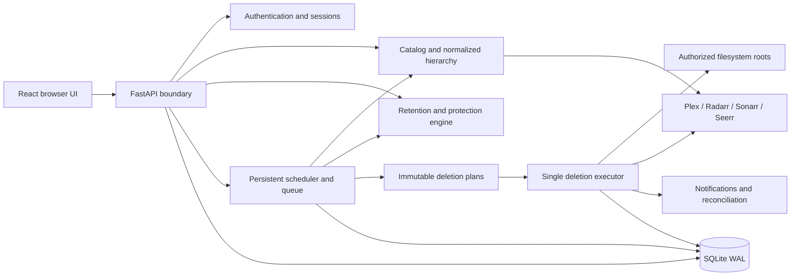

# Architecture

Deletarr is a modular monolith. The browser only uses the same-origin authenticated API. It never receives integration tokens. The application has one administrator, one process, one SQLite database and one active executor.

## Ownership

| Module | Responsibility |
| --- | --- |
| `app.py` | Typed internal API, request boundary, configuration and orchestration |
| `security.py` | Argon2id, opaque hashed sessions, credential encryption, outbound URL/DNS trust |
| `db.py` | Schema migrations, transaction serialization, UTC timestamps, consistent backup |
| `integrations.py` | Bounded HTTP, supported Plex/manager/Seerr contracts and postconditions |
| `catalog.py` | Stable UUID catalog, external IDs, hierarchy, many-to-many physical files, watch events and requests |
| `rules.py` | Typed bounded predicate trees, traces, scope/priority selection and global protections |
| `filesystem.py` | Root authorization, mount validation, source mapping, identity checks and exact unlink |
| `storage.py` | Volume-specific pressure recovery selection with hardlink-aware estimates |
| `executor.py` | Plans, state transitions, final validation, monitoring preconditions, deletion and reconciliation |
| `jobs.py` | Durable queue, cron/interval scheduler, cancellation, retries and notification delivery |
| `web/src` | Responsive management interface and API client |

## Data model

`media` stores movie/show/season/episode records with parent foreign keys. `media_files` is many-to-many: editions/multipart movies and shared multi-episode files are represented without assuming one file per item. `external_ids` normalizes Plex-linked TMDB/TVDB/IMDb identifiers; physical paths and titles are never sole item identities. `watch_events` uses unique external event keys; `media` retains aggregate watch state. Requests preserve request/season/time/media links.

Rules retain versioned typed condition JSON and scope columns. Evaluations store condition traces. Candidates retain approval/grace/decision state and a concurrency version. Plans embed exact affected item/file identity snapshots; operations, checkpoints and reconciliation persist execution state. These snapshots remain even when the source disappears.

Settings, administrator, sessions, login attempts, encrypted integrations, authorized roots/mappings, libraries, schedules/jobs, notification destinations/deliveries, audit events and storage snapshots complete the operational model. Logical entities are combined when a separate table would duplicate an invariant (for example show/season/episode in one constrained hierarchy, conditions as a validated tree).

Migrations are additive versions 1–4 with transactional later steps. Startup refuses a newer schema. The application does not perform down-migrations. Back up before upgrading; recovery restores the matching database, credential key and runtime version while stopped. See OPERATIONS.md.

## Retention semantics

Lower numerical priority wins. At equal priority, library-specific rules precede global rules; UUID is the deterministic final tie-breaker. A rule's non-null library/type narrows its applicability. The first eligible rule owns an item's candidate. Protection applies to descendants and ancestors; media with uncertain required facts cannot qualify. An excluded library is always protected. A show or season scope requires every represented leaf/file to pass protection, and watched-based aggregate rules require affirmative evidence for every leaf.

All times are UTC seconds in persistence; display uses the administrator's IANA timezone. Durations use elapsed seconds (days are 86400 seconds), while schedules use timezone-aware calendar cron expressions.
