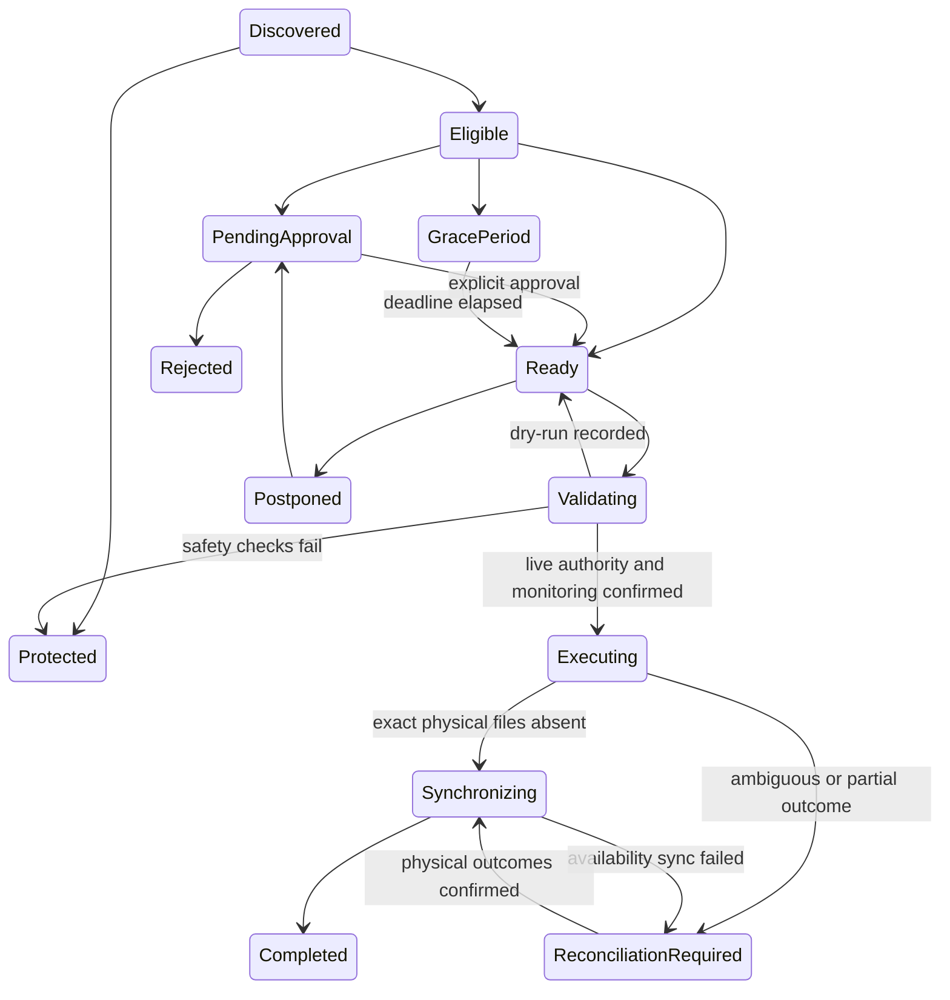

# Execution, deployment and recovery

## Modes and authority

First installation is dry-run. Simulations perform reads and record plans/results without unmonitoring, deletion or Seerr availability writes. Live enrollment requires the administrator password and the phrase shown in Deletion Safety. A queued manual simulation cannot become live because mode changed after submission. Scheduled live jobs operate only on currently authorized rule actions, approvals and expired grace periods.

Manual plan confirmation includes the number of movie/episode leaves and the exact sum of logical bytes. It is not a claim about secure erasure or physically reclaimed space. Approvals, grace deadlines and postponements are checked again at execution time. Editing a rule increments its version, invalidates old approval state, queues reevaluation and makes stale plans unusable.

## State machine

All implemented transitions are allowlisted in `executor.py`; audit events record previous and target state. Rule reevaluation can produce or protect candidates without executing them. Rejected and completed decisions are retained. Grace has explicit eligible/due timestamps. Postponement does not silently grant approval; an administrator reapproves after the chosen deadline, or reevaluation retains the decision for review.

## Normal execution

1. Build an immutable plan with current rule/version, affected hierarchy, exact files, stored physical identities, manager strategy, estimates and expected postconditions. Plans expire after 15 minutes.
2. Verify current authorization, source scope, TV descendants, owner-visible watch history, Seerr requests, Plex sessions, protections, paths, mount identity and limits.
3. Persist an operation and manager-precondition checkpoint. Verify source-to-manager file mapping and monitoring changes. Unknown manager associations refuse direct-file fallback.
4. Revalidate after monitoring. Before each exact-file request, check cancellation/shutdown, protection, identities and playback again. Managed requests use moviefile/episodefile endpoints; unmanaged operations unlink one descriptor-relative regular file.
5. Verify the mount is still authorized, local target is absent, and manager file record is absent when applicable. Record a confirmed file checkpoint.
6. Optionally remove the whole manager record with file recursion disabled and import exclusion requested/verified.
7. Record logical bytes, allocated-block estimate and observed free-space delta. The delta is explicitly not attributable to Deletarr alone.
8. Update supported Seerr aggregate availability. Any failure records the actual state and a reconciliation task.

The external API boundary cannot guarantee immunity from a manager plugin, remote file rename or hostile concurrent writer. Keep management roots narrowly scoped, disable third-party deletion hooks with unrelated side effects, and schedule cleanup outside import/migration windows.

## Interrupted or failed operations

A request marked started may already have succeeded. **Do not resend a destructive request simply because a timeout occurred.** Inspect History → operation, exact plan, file checkpoints, manager state and mount health.

The Reconcile job never reissues physical DELETE/unlink requests. It verifies previously attempted file absence under the authorized mount, updates local file state and resumes supported availability synchronization when the whole physical scope is confirmed. A partial scope or ambiguous/unconfirmed record-removal checkpoint stays pending for operator intervention. It does not restore media.

For an incomplete operation:

1. Turn dry-run on to stop new destructive work.
2. Verify host mounts and current file identities. Reauthorize a changed root only after confirming it is the intended volume, then sync again.
3. Inspect actual Radarr/Sonarr monitoring, file inventory and import exclusions.
4. Resolve the remote state using its administration interface. Never remove an entire series to resolve a failed episode deletion.
5. Run Reconcile for supported postconditions. For repairs that cannot be verified automatically, use “Record external resolution” with the exact phrase and an evidence note. Physical absence is still verified; the result is explicitly ReconciledManually, not an automatic postcondition claim. Do not edit SQLite to manufacture success.

Graceful shutdown sets an executor stop flag before waiting for the current request to return. It prevents new physical work and records partial state. Compose grants 120 seconds. SIGKILL/power loss can interrupt at any checkpoint; startup moves incomplete live operations into reconciliation and does not replay a running destructive job. One flock-protected process owns the config directory.

## Limits and storage pressure

Limits count unique movie/episode leaves, physical files, logical bytes, reclaim estimates and library percentage across the current plan and live attempts in the previous 24 hours. A failed/ambiguous attempt conservatively reserves its planned scope. Separate manual submissions cannot reset the safety budget.

Pressure policies are volume-specific. Absolute values are stored in bytes; the UI accepts GB/TB, GiB/TiB, or raw bytes with explicit conversions. Percentage thresholds use volume total blocks. The recovery target must exceed the trigger threshold. Watched candidates sort by the oldest latest-watch event. Never-watched candidates have a separate explicit oldest-added/newest-added/excluded policy; their missing watch dates are never invented. Shared files, protected content, unknown facts and global limits still apply. Files with another hardlink are estimated at zero reclaimed blocks and do not advance a recovery plan. The worker rechecks real capacity between executed plans and stops at the target.

A missing network mount is not an empty library. Root identity and random sentinel checks must pass before file inspection, after deletion and during reconciliation. Empty libraries or source disappearance never authorize local deletion.

## Backup, upgrades and restore

Settings → Backup creates a SQLite online backup under `/config/backup-<uuid>.db` with mode 0600. It includes private catalog/history, password hashes, sessions and encrypted credentials. Copy `/config/credentials.key` separately to protected storage. A database without its matching key cannot decrypt integrations or webhook destinations.

Before an upgrade, enable dry-run, stop destructive jobs, create a backup and record the image version. Upgrade with the same config volume. Startup applies additive migrations transactionally and refuses a database newer than the runtime. No down-migration is promised.

For disaster recovery, stop the container, preserve the current config separately, restore a consistent backup as `deletarr.db` and its matching key, and ensure no old WAL/SHM files remain alongside the restored database. Set owner/mode correctly. Start the matching application version on an isolated network, verify dry-run, rotate passwords/API keys if necessary, invalidate restored sessions by changing the administrator password, verify mounts and inspect reconciliation before reconnecting integrations.

Restoring a backup can restore prior live enrollment. Review mode immediately in an isolated environment before schedules can contact real services. For inspection, mount media read-only and leave integrations unreachable. A UI settings export is not a disaster-recovery backup.

## NAS and permissions

Do not run privileged or as root to solve media permissions. Use the media owner/group or deliberate ACLs; ensure Deletarr can traverse, stat and unlink only intended media trees. Keep `/config` private and writable by its UID. Host-mounted SMB/NFS may not offer stable Unix inode/hardlink semantics; test identity stability, disconnect handling, unlink behavior and snapshots before live use. When identity checks cannot be satisfied, cleanup remains blocked.

## Viewing-history privacy

Observed history is stored locally in SQLite (`watch_events` plus aggregate media timestamps). Events retain the external Plex user identifier, not a downloaded Plex account credential. An observed playback without an affirmative watched marker is stored with completion uncertain, protects recent playback and does not become proof that a title was watched. Watch-dependent cleanup remains protected if recent relevant history cannot be interpreted safely.

History is not sent to notification services: delivery includes the configured event and a summary title/message. Backups include history and should be retained accordingly. Removing a Plex connection does not erase operational evidence. To erase all locally retained viewing and audit history, stop the application and remove its **application config volume and protected backups** according to your host administration procedure, then initialize a fresh installation. This resets settings/accounts/rules as well; it does not require removing mounted media. Plex retains its own independent history.
